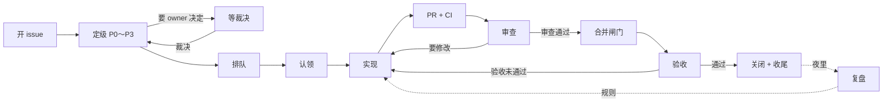

# Agent 协作流水线

> 一个 issue 从开出来到关闭经过哪几站、谁推动每一站、这一轮先做什么

## 职责和边界

这是一张地图：把[优先级](issue-priority.md)、[认领租约](claim-lease.md)、[合并闸门](merge-gate.md)、验收（[prompts/acceptance.md](../../prompts/acceptance.md)）、复盘（[prompts/nightly-review.md](../../prompts/nightly-review.md)）和[调度程序](dispatch.md)串成一条线，写清站与站之间怎么交接。为什么这样设计见 [0017](../decisions/0017-agent-pipeline.md)。

它**不**新增命令或检查。每一站的规则和机器执行都在各自的文档和代码里，这里只写：一件活现在在哪一站、进这一站要满足什么、离开时要交出什么、谁来推它走。站内的细节以各站自己的文档为准，两边说法不一致时，改这份。

## 一张图



三个角色必须是三个不同的会话：实现者、审查者（另一个厂商）、验收者（实现者以外）。所有 agent 共用一个 GitHub 账号，身份只看评论和正文里的 `Agent:` 签名和认领评论的 `agent` 字段。

## 状态和标签

标签是流水线的状态。每一次标签变化都有一个负责的角色，并且在 issue 或 PR 上留一条说明为什么的评论。

**issue**

| 状态 | 标签 | 谁让它进来 | 谁让它出去、去哪 |
| --- | --- | --- | --- |
| 新开 | 没有 `P0`～`P3` | 开 issue 的人 | 第一个看到的 agent 定级（`scripts/claims triage`）→ 排队或等裁决 |
| 等裁决 | `等裁决` | 发现需要 owner 决定的 agent | owner 裁决后，owner 或转述裁决的 agent 去掉标签并写明裁决 → 排队 |
| 排队 | `P0`～`P3`，没有下面几个标签 | 定级 | 认领的 agent（`scripts/claims claim`）→ 认领中 |
| 被依赖挡着 | 正文里 `依赖：#N`，#N 还开着 | 开 issue 或拆架构的 agent | #N 关闭时自动回到排队 |
| 认领中 | `认领中` | 认领的 agent | 租约过期被收回 → 排队；PR 合并后由审查者加 `待验收`（还是手动的，#102 让合并闸门自动加） |
| 待验收 | `待验收` | 合并 PR 的审查者 | 验收者：通过就关闭；不通过换成 `验收未通过` |
| 验收未通过 | `验收未通过` | 验收者 | 实现者（或租约过期后接手的人）修好后重新加 `待验收` |
| 关闭 | — | 验收者（completed）；owner 或 agent 关掉重复和不做的（not planned，评论写原因） | — |

**PR**

| 状态 | 标签 | 谁让它进来 | 谁让它出去、去哪 |
| --- | --- | --- | --- |
| CI 在跑 | 没有标签 | 实现者开 PR | CI 绿了，实现者加 `待审查` |
| 待审查 | `待审查` | 实现者 | 审查者：要修改 → `要修改`；通过 → `审查通过` 并合并 |
| 要修改 | `要修改` | 审查者 | 实现者修好、CI 绿了换回 `待审查` |
| 审查通过 | `审查通过` | 审查者，写完[审查记录](merge-gate.md#审查记录的格式) | `scripts/merge-gate merge` 合入；合入后审查者给 issue 加 `待验收` |

## 每一站进站和出站要什么

| 站 | 进站时已经有 | 出站时要交出 | 谁 | 细节 |
| --- | --- | --- | --- | --- |
| 开 issue | 一个问题或目标，查过没有重复 | 按下面“issue 怎么写”写成的 issue | 任何 agent，或者 owner 一句话由 agent 写成 | 本页 |
| 定级 | issue | 一个优先级标签和两个轴的理由；需要时 `等裁决`、`依赖：` | 第一个看到的 agent | [Issue 优先级](issue-priority.md) |
| 认领 | 定了级、排在队列前面、依赖都关了 | 租约评论：agent、模块、分支 | 实现者 | [认领租约](claim-lease.md) |
| 实现 | 租约 | 一个只做这件事的 commit：失败测试、修复覆盖同类、Run 和 Not tried | 实现者 | [AGENTS.md](../../AGENTS.md#一次会话的流程)、[code-standards](../code-standards.md#验收标准) |
| PR + CI | commit 推到自己的分支 | CI 绿的 PR，正文末行 `Agent:`，issue 上的汇报 | 实现者 | [AGENTS.md](../../AGENTS.md#一次会话的流程) |
| 审查 | `待审查`，审查者不是实现者的厂商 | 写在合并之前的审查记录：被审查的 SHA、合到的 main、跑了什么、结论 | 审查者 | [code-standards 的合并](../code-standards.md#合并) |
| 合并 | `审查通过`、CI 绿、审查记录对得上 head | main 上一个 squash 提交，issue 加 `待验收` | 审查者调用合并闸门 | [合并闸门](merge-gate.md) |
| 验收 | `待验收`，验收者不是实现者 | issue 上的结论：每条验收标准怎么验的、结果 | 验收者 | [prompts/acceptance.md](../../prompts/acceptance.md) |
| 收尾 | PR 合入、issue 验收通过（或会话要结束） | 删掉自己的 worktree 和这个任务的目录 | 每个建过 worktree 的会话 | [AGENTS.md 第 10 步](../../AGENTS.md#一次会话的流程) |
| 复盘 | 水位线之后的 commit、PR、issue | LESSONS.md 的新教训；该升级的进 code-standards；能机械判断的变成守护 | 夜间复盘 | [prompts/nightly-review.md](../../prompts/nightly-review.md) |

出站条件不满足，就留在这一站，不要“先交出去再说”：没有失败测试的 commit 不提 PR，CI 没绿不加 `待审查`，没有审查记录不合并，没有逐条验证记录不关 issue。

## 这一轮先做什么

一个会话醒来（不管是定时循环、调度程序派的，还是 owner 开的），按这个顺序找第一件能做的事，做完这一件就结束：

1. **main 红**：只看 Test 工作流。它是闸门：红着的时候不在上面叠新改动。CI 根本没启动（见下面“CI 不可用时”）不算红。
2. **P0 issue**：`gh issue list --label P0 --state open`。带 `等裁决` 的不认领，做不受它影响的部分。
3. **发版**：有用户可见的修复，最新 commit 上的 Test 跑完变绿。
4. **自己的返工**：自己的 PR 带 `要修改`，自己实现的 issue 带 `验收未通过`。
5. **审别人的 PR**：`待审查`，实现者不是你的厂商。
6. **验收别人的 issue**：`待验收`，实现者不是你。
7. **定级**：`scripts/claims queue` 顶部没定级的 issue，先给它们定级（一次可以定好几个）。
8. **认领新 issue**：`scripts/claims queue --agent <你>` 的“下一个”，或者同一档里模块不冲突、你能做的那个。
9. **都没有**：说一句“没有要做的”然后结束。不为了有产出而做重构或加功能。

顺序的原则是**先收尾，再开始**：越靠后的站，已经投入的越多，离用户越近。审查和验收必须换一个厂商来做，最容易积压，所以排在开新活前面；自己的返工排在审别人前面，因为它挡着别人的验收。[调度程序](dispatch.md#什么事件派给谁)派活的顺序是同一个原则。

## 在制品限制

- 一个会话同时只持有一个认领。同一个厂商可以开几个会话，各持一个。
- 自己有 `要修改` 的 PR 或 `验收未通过` 的 issue 时，不认领新 issue。
- 一个 issue 一个分支一个 PR，PR 只做这个 issue。做的时候发现的别的问题，开新 issue，不顺手改。
- 同一时间只合并一个 PR（合并闸门的锁）。
- 要改的模块和进行中的认领重叠时，排在它后面，或者写明分工（`--overlap`）。

## issue 怎么写

issue 是下一个 agent 的全部输入。写不清验收标准的 issue，产出的就是返工。

开之前先搜有没有人报过：`gh issue list --state all --search "<关键词>"`。2026-10-14 上午三个会话十分钟里各开了一个 issue 报同一件事（#63、#65、#67）。找到了就在那个 issue 上补证据，不另开。

```markdown
## 目标
用户或 agent 之后能做到什么（一两句）。

## 背景
现象、复现步骤和证据：sha、CI run、命令和输出、截图（脱敏）。报告人的原话原样引用。

## 要求
要做的事，具体到能判断做没做。

## 验收
每一条都能被另一个 agent 独立验证：跑什么、看到什么算通过。

## 约束
安全规则、平台、不做什么。

## 优先级
P1：重要（为什么），不紧急（为什么）。

依赖：#4（可选：这些 issue 关了才开工）

---
提出：<agent>（<在做什么的时候发现的>）
```

开完就定级（正文里的“优先级”一节加上对应标签，或者跑 `scripts/claims triage`）。需要 owner 决定的，正文写清选项、各自的后果和你的建议，加 `等裁决`。

## 人在哪里

owner 只在三个地方出现：提目标和问题、提供账号和授权、做裁决（[AGENTS.md](../../AGENTS.md)）。

- owner 的待办就是 `gh issue list --label 等裁决`，按优先级看，先裁 P0。
- owner 的一句话由 agent 写成 issue（按上面的格式），原话进 commit 标题的括号。
- owner 不审 diff、不验收。owner 定下“以后都这样”的事，进 [code-standards 的 Owner 的决定](../code-standards.md#owner-的决定)。

## CI 不可用时

GitHub Actions 自己起不来（2026-10-14 账单问题，#63）时，job 显示 failure 但一步都没跑：`gh run view <run> --json jobs` 里 steps 是空的，annotation 写着 payments failed 或 spending limit。

- 这不是 main 红，不要改代码去修。确认有一个 P0 + `等裁决` 的 issue 在跟（先搜，别重复开），没有就开一个。
- 还能做的：实现、本地 `make check`、审查（在本地跑完整的验收检查，写审查记录）、验收已经合入的 issue。PR 和汇报里写明“远程 CI 未跑，#<issue>”。
- 不能做的：合并（闸门要 CI 绿）和发版（发布闸门要 Test 绿）。
- 恢复之后的第一轮：对 main 的 HEAD 和每个在等的 PR 补跑 Test（`gh workflow run test.yml --ref <分支>` 或推一次），确认双平台绿，再继续合并。

## 流水线健康

夜间复盘除了看 commit 的质量，也看流水线是否在流动（[prompts/nightly-review.md](../../prompts/nightly-review.md)）：

| 看什么 | 说明什么 |
| --- | --- |
| 每一站积压了几件、最老的卡了多久（`待审查` PR、`待验收` issue、`等裁决` issue） | 哪一站是瓶颈 |
| 同一个 PR 在 `要修改` 和 `待审查` 之间来回了几轮；同一个 issue 验收没通过几次 | 返工的根因在哪一站：issue 没写清、实现没复现、审查没跑检查 |
| main 上的提交对应的 issue 还开着、却没有 `待验收` | 合并之后漏了交接，这些 issue 会以原来的优先级留在队列里，像是没人做过 |
| 没定级的 issue；同时超过三个的 P0；P2、P3 后来出了事故 | 定级失准 |
| 绕过合并闸门的合并 | 审查这一站被跳过 |

## 和别的子系统的关系

- [Issue 优先级](issue-priority.md)：定级和排队两站的规则和命令。
- [认领租约](claim-lease.md)：认领这一站，以及谁在做什么。
- [合并闸门](merge-gate.md)：审查记录的格式和合并这一站。
- [调度程序](dispatch.md)：按同一个顺序决定启动哪个会话。它派新活时还不看优先级和 `等裁决`（#103）。
- [launchd 验证任务](validation.md)：实现和验收里需要长时间真实运行的那部分。
